# DriftGuard

**PostgreSQL Schema Drift, Live Operations Monitoring, Architecture Diagram Studio & Governance SaaS**

[](https://www.postgresql.org/)
[](https://react.dev/)
[](https://www.typescriptlang.org/)
[](https://orm.drizzle.team/)
[](https://tailwindcss.com/)
[](#-dark-mode-theme)
[](#-localization)

DriftGuard is a full-stack PostgreSQL observability, live operations monitoring, and schema governance platform. Using strictly **read-only catalog inspection**, it detects undocumented schema drift via canonical SHA-256 baselines, monitors real-time TPS, connection pools, XID wraparound, and `pg_stat_activity` **long-running root blocker trees**, generates live interactive **UML & Architecture diagrams**, audits PostgreSQL privileges and replication lag, gates unsafe migrations in CI/CD pipelines, and automatically re-inspects databases when custom health score thresholds are breached.

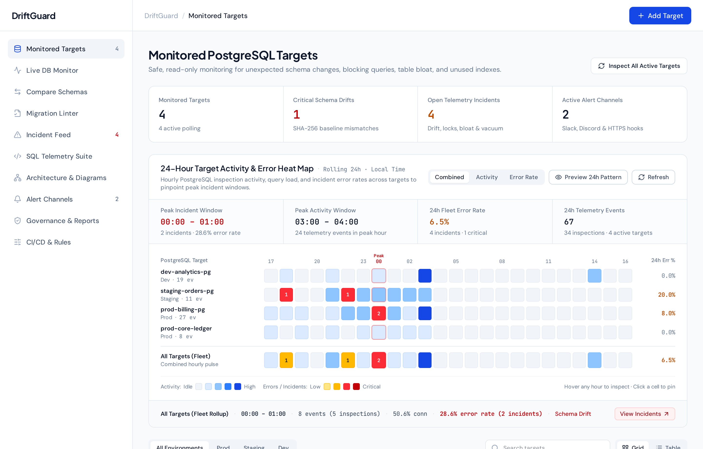

---

## Core Capabilities

| Module | What It Does |
| :--- | :--- |
| **Live DB Monitor & Blocker Tree** | Streams real-time TPS, connection pool saturation, active sessions (`pg_stat_activity`), **Long-Running & Root Blocker Trees** via `pg_blocking_pids(pid)` with safe `pg_cancel_backend` / `pg_terminate_backend` remediation SQL, I/O & tuple throughput, Checkpoints & BGWriter stats, XID wraparound & vacuum progress, and `pg_settings` tuning audits. |
| **Architecture & UML Diagram Studio** | Renders 7 interactive, live-hydrated engineering diagrams — **Use Case (UML)**, **Sequence (UML)**, **System Architecture**, **Data Flow (DFD)**, **State Machine**, **Live ERD & Data Model**, and **Replication & HA Topology** — with pan/zoom, element inspection, and SVG, PNG, Mermaid.js, and PlantUML export. |
| **Canonical Schema Drift & Time Machine** | Captures deterministic SHA-256 hashes of `information_schema.columns`, diffs live schemas against promoted Git baselines, browses historical snapshots in a **Schema Time Machine**, and generates forward Up-Migration and Down-Rollback Sync SQL. |
| **24-Hour Activity Heat Map & Bulk Ops** | Visualizes hourly target activity levels, inspection volume, and incident error rates across the fleet, pairs every target with 7-day health sparklines, and supports multi-select checkboxes for concurrent **Inspect** and **Delete** operations. |
| **SQL Telemetry Suite** | Includes live `pg_stat_statements` monitoring, **30-Day Performance Trends** vs. baselines, **Index Advisor** (`EXPLAIN` + sequential scan ESR composite index recommendations), Live Lock Contention graph, Capacity Forecasting, Vacuum/Bloat Anomaly Trends, and **Replication Lag & WAL Slot** monitoring. |
| **Security & Privilege Drift Auditor** | Audits PostgreSQL superuser roles, missing Row-Level Security (RLS) policies, risky `PUBLIC` grants, and non-SSL client sessions with copy-ready remediation SQL. |
| **Pre-Flight Migration Linter & Compare** | Statically audits DDL migrations for table-locking operations (`ACCESS EXCLUSIVE`, non-concurrent indexes, missing `lock_timeout`), outputs safe wrapped SQL, and compares staging vs. production schemas side by side. |
| **Governance, RBAC & Executive Reports** | Generates weekly/monthly **Executive Health Digests** (SLA availability, MTTR, storage projections) with PDF/CSV/JSON export, enforces **Production Baseline Promotion Approvals**, manages **Admin / DBA / Viewer RBAC**, and schedules **Maintenance Windows** to silence alerts during planned deploys. |
| **Health Score Auto-Inspection & CI/CD** | Configures custom 0–100 minimum health score thresholds and anti-loop cooldown windows per target, enforces GitHub Actions drift gates (`X-DriftGuard-Key`), and dispatches AES-256-GCM encrypted Slack, Discord, and HTTPS webhooks. |
| **Dark Mode & EN / Burmese i18n** | Instant runtime **Light / Dark mode** toggle engineered for high-contrast telemetry grids and incident logs, plus full **English (`en`)** and **Burmese (`my`)** localization across every screen. |

---

## Product Screenshots

> All screenshots below are captured directly from the live DriftGuard application running on the pre-seeded Demo Workspace (`demo@driftguard.dev`).

### 1. Fleet Dashboard, 24-Hour Activity Heat Map & Bulk Target Operations
Monitor every PostgreSQL cluster across Production, Staging, and Development from a unified Grid or Table workspace. Pinpoint peak incident hours on the 24-hour heat map, track 7-day health score sparklines per database, and run concurrent inspections or deletions via bulk selection.


---

### 2. High-Contrast Dark Mode Dashboard
Toggle cleanly between Light and Dark mode from the sidebar. Every telemetry grid, heat map cell, incident feed, SQL code block, and blocker tree uses high-contrast dark surfaces (`slate-950` / `slate-900`) for comfortable overnight on-call and DBA triage.

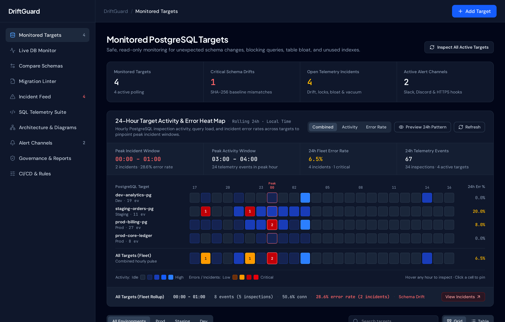

---

### 3. Live DB Monitor — Long-Running Queries & Root Blocker Tree (`pg_stat_activity`)
Visualize multi-level lock contention chains directly from `pg_stat_activity` and `pg_blocking_pids(pid)` in a cycle-safe hierarchical tree. Instantly separate **Root Blockers** (such as abandoned `idle in transaction` sessions or `ALTER TABLE` DDL) from transitive blockers, leaf waiters, and standalone long-running queries, filter by minimum duration (`≥1s` to `≥60s`), jump directly to any root PID, and copy safe `pg_cancel_backend` / `pg_terminate_backend` or diagnostic SQL commands.

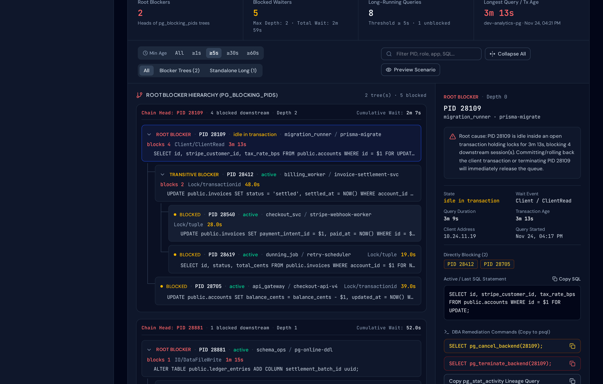

---

### 4. Live PostgreSQL Operations Monitor — Throughput, Pool & Sessions
Track real-time TPS and active session trends, connection pool allocation (`Active`, `Idle-Tx`, `Idle`, `Free`), buffer cache hit ratio, temp file spills, XID wraparound safety, vacuum progress, and `pg_settings` tuning recommendations with configurable 5s / 15s / 30s live polling.

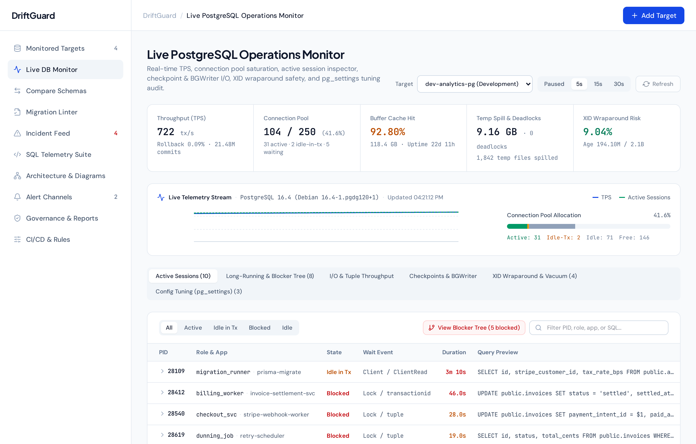

---

### 5. Architecture & UML Diagram Studio
Inspect and export 7 interactive engineering diagrams hydrated from your workspace metadata — **Use Case (UML)**, **Sequence (UML)**, **System Architecture**, **Data Flow (DFD)**, **State Machine**, **Live ERD & Data Model**, and **Replication & HA Topology** — with click-to-inspect technical specs and one-click SVG, PNG, Mermaid.js, and PlantUML export.

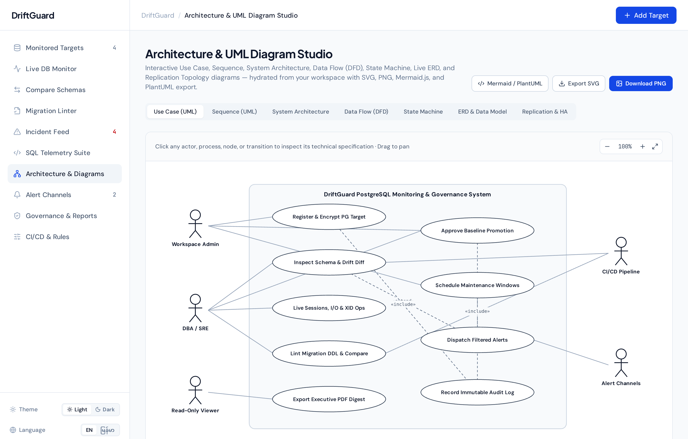

---

### 6. Target Detail View, SHA-256 Schema Diff & Event Timeline
Drill into any monitored target to inspect column-level additions, removals, and type modifications against your promoted Git commit baseline, browse the Schema Time Machine and Security Privilege Auditor, export a formatted PDF Health Report, and audit every schema change, alert trigger, and manual scan in the chronological **Event Timeline** sidebar.

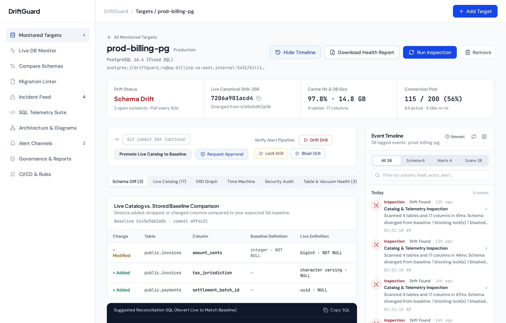

---

### 7. SQL Telemetry Suite — 30-Day Performance Trends
Spot query latency regressions over 7, 14, or 30 days compared against historical baselines, highlighting regression spikes across top `pg_stat_statements` queries.

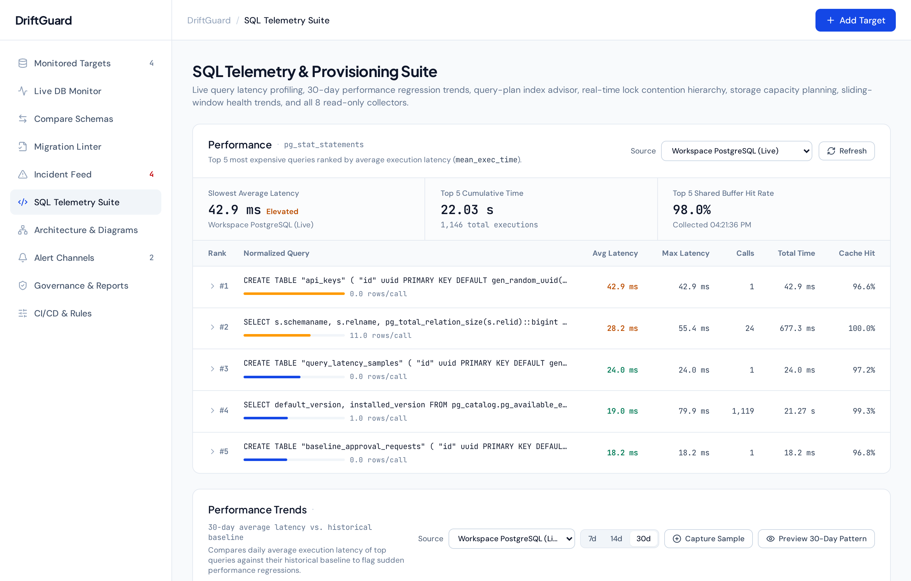

---

### 8. SQL Telemetry Suite — Index Advisor & Sequential Scan Hotspots
Analyze `EXPLAIN` query plans and high-latency sequential scan hotspots to generate copy-ready `CREATE INDEX CONCURRENTLY` single-column and ESR (Equality → Sort → Range) composite B-Tree index recommendations.

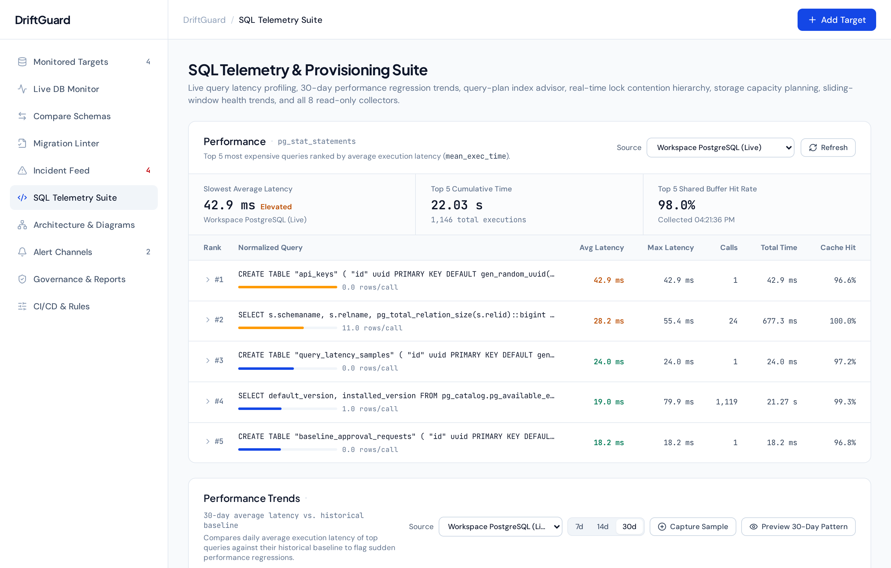

---

### 9. Governance, Team RBAC & Executive Health Digest
Review fleet-wide SLA availability, average health scores, incident MTTR, and 30-day storage growth forecasts, export executive digests as PDF/CSV/JSON, review Production baseline promotion approval requests, and manage Admin/DBA/Viewer team roles.

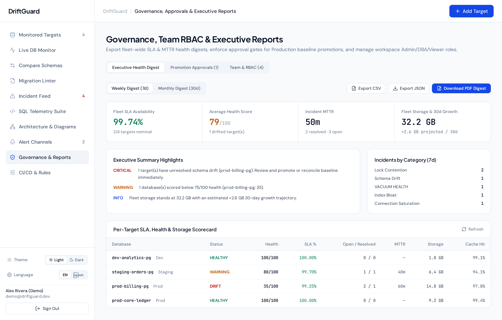

---

### 10. CI/CD Gates & Per-Target Health Score Auto-Inspection
Configure custom minimum 0–100 health score thresholds and anti-loop cooldown windows per database alongside Maintenance Windows and GitHub Actions API keys. Whenever a database's computed health score drops below its threshold, DriftGuard automatically executes a verification re-inspection and records the event in the immutable Activity Audit Log.

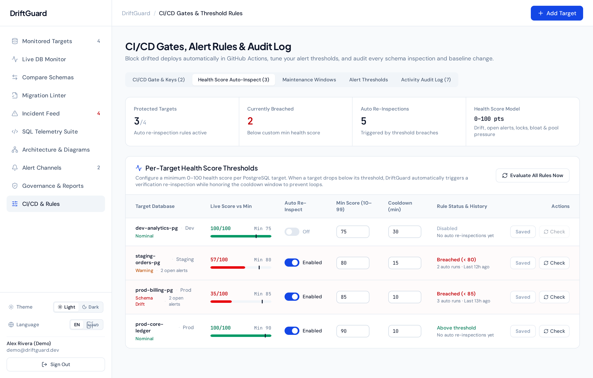

---

## Architecture & Tech Stack

```text
┌──────────────────────────────────────────────────────────────────────┐
│                        React 19 + Vite SPA                           │
│   Tailwind CSS v4 (Light/Dark) · Lucide Icons · SVG Charts & UML     │
│   EN / MY i18n · Firebase Client Auth (Bearer ID Tokens)             │
└─────────────────────────────────┬────────────────────────────────────┘
                                  │ HTTPS / JSON API (/api/*)
┌─────────────────────────────────▼────────────────────────────────────┐
│                    Express + TypeScript Server                       │
│  • Firebase Admin Auth Middleware + Zod Request Validation           │
│  • AES-256-GCM Secret Vault (HKDF Key Derivation)                    │
│  • SSRF Guard (DNS Resolution & Private/Link-Local IP Blocking)      │
│  • Read-Only PostgreSQL Inspector (statement_timeout + read-only tx) │
│  • Live Operations Service (pg_stat_activity + pg_blocking_pids)     │
│  • Per-Target Health Score Evaluator & 60s Background Watcher        │
│  • PDFKit Health/Executive Digest Generator & Webhook Dispatcher     │
└───────────────┬─────────────────────────────────────┬────────────────┘
                │ Drizzle ORM                         │ Read-Only pg Pool
┌───────────────▼──────────────────┐   ┌──────────────▼────────────────┐
│   DriftGuard Control Plane DB    │   │   Monitored Target Clusters   │
│   PostgreSQL / Cloud SQL         │   │   PostgreSQL 13+ (Prod/Stg)   │
│   Normalized Governance Tables   │   │   information_schema,         │
│   (Users, Targets, Baselines,    │   │   pg_stat_activity, pg_locks, │
│    Snapshots, Incidents, RBAC,   │   │   pg_stat_statements,         │
│    Approvals, Windows, Audit)    │   │   pg_stat_bgwriter, pg_roles  │
└──────────────────────────────────┘   └───────────────────────────────┘
```

### Tech Stack
- **Frontend:** React 19, TypeScript, Vite 8, Tailwind CSS v4 (`@custom-variant dark`), Lucide React
- **Backend:** Node.js, Express 4, TypeScript (`tsx`), Zod 4, PDFKit
- **Database & ORM:** PostgreSQL (Cloud SQL), Drizzle ORM, `pg`
- **Authentication:** Firebase Authentication (Client SDK + `firebase-admin` server verification)

---

## Getting Started

### Prerequisites
- **Node.js 20+**
- **PostgreSQL 13+** (for the DriftGuard control plane database)
- **Firebase Project** with Authentication enabled (Google / Email-Password)

### 1. Clone & Install Dependencies

```bash
git clone <your-github-repo-url>
cd driftguard
npm install
```

### 2. Configure Environment Variables

Copy `.env.example` to `.env` and fill in your values:

```bash
cp .env.example .env
```

| Variable | Required | Description |
| :--- | :---: | :--- |
| `SQL_HOST` | Yes | Control-plane PostgreSQL host (or Cloud SQL socket/IP) |
| `SQL_DB_NAME` | Yes | Control-plane PostgreSQL database name |
| `SQL_USER` / `SQL_PASSWORD` | Yes | Application database credentials |
| `ENCRYPTION_KEY` | Recommended | 32+ character secret for AES-256-GCM encryption of target URIs & webhook URLs |
| `APP_URL` | Optional | Public URL of your DriftGuard deployment |

Configure `firebase-applet-config.json` with your Firebase Web App credentials.

### 3. Push Database Schema

```bash
npx drizzle-kit push --config=src/db/drizzle.config.ts
```

### 4. Run Locally

```bash
# Development server (Express API + Vite middleware on port 3000)
npm run dev

# Type-check
npm run lint

# Production build & start
npm run build
npm start
```

Open **http://localhost:3000** in your browser.

### 5. Instant Live Demo Workspace
Want to explore every feature without connecting your own PostgreSQL cluster first? Click **"Try Live Demo Workspace"** on the sign-in screen to launch an isolated demo session (`demo@driftguard.dev`) pre-populated with 4 PostgreSQL clusters (`prod-billing-pg`, `prod-core-ledger`, `staging-orders-pg`, `dev-analytics-pg`), live multi-level `pg_stat_activity` blocker trees, interactive UML & ERD diagrams, 7-day health trends, 24-hour activity heat map telemetry, open schema drift & lock incidents, 30-day query latency regressions, configured health-score auto-inspect rules, governance approvals, Slack/Discord alert channels, and audit logs.

---

## Provisioning a Read-Only Target Role

DriftGuard only ever executes read-only metadata and telemetry queries. To connect an external PostgreSQL 13+ cluster safely, create a dedicated least-privilege role:

```sql
CREATE ROLE driftguard_ro WITH LOGIN PASSWORD 'replace-with-strong-password';
GRANT pg_monitor TO driftguard_ro;
GRANT CONNECT ON DATABASE your_database TO driftguard_ro;
GRANT USAGE ON SCHEMA public TO driftguard_ro;
GRANT SELECT ON ALL TABLES IN SCHEMA information_schema TO driftguard_ro;
```

> Granting `pg_monitor` enables full visibility into `pg_stat_activity`, `pg_blocking_pids(pid)`, `pg_stat_bgwriter` / `pg_stat_checkpointer`, `pg_stat_progress_vacuum`, `pg_stat_replication`, and `pg_settings`. Enable `pg_stat_statements` to unlock **Query Performance**, **30-Day Performance Trends**, and **Index Advisor** query plan analysis.

---

## CI/CD GitHub Actions Schema Gate

Block pull requests automatically (HTTP `409`) whenever undocumented schema drift is detected, and promote the new Git commit SHA baseline right after production migrations succeed:

```yaml
name: DriftGuard Schema Gate
on:
  pull_request:
    branches: [main]
  push:
    branches: [main]

jobs:
  schema-drift-check:
    runs-on: ubuntu-latest
    steps:
      - name: Verify zero undocumented drift before deploy
        run: |
          curl --fail-with-body -sS -X POST "${{ vars.DRIFTGUARD_URL }}/api/ci/check-drift" \
            -H "Content-Type: application/json" \
            -H "X-DriftGuard-Key: ${{ secrets.DRIFTGUARD_API_KEY }}" \
            -d '{"databaseId":"${{ vars.DRIFTGUARD_TARGET_ID }}"}'

      - name: Promote new Git baseline after production migration
        if: github.ref == 'refs/heads/main'
        run: |
          curl --fail-with-body -sS -X POST "${{ vars.DRIFTGUARD_URL }}/api/ci/check-drift" \
            -H "Content-Type: application/json" \
            -H "X-DriftGuard-Key: ${{ secrets.DRIFTGUARD_API_KEY }}" \
            -d '{"databaseId":"${{ vars.DRIFTGUARD_TARGET_ID }}","promoteBaseline":true,"gitCommitSha":"${{ github.sha }}"}'
```

---

## API Reference Overview

All `/api/*` endpoints (except `/api/health` and `/api/ci/check-drift`) require a valid Firebase ID token via `Authorization: Bearer <token>` and enforce strict per-user `ownerUid` tenant isolation.

| Domain | Endpoints |
| :--- | :--- |
| **Targets & Bulk Ops** | `GET /api/databases`, `POST /api/databases`, `PATCH /api/databases/:id`, `DELETE /api/databases/:id`, `POST /api/databases/:id/inspect`, `POST /api/databases/inspect-all`, `POST /api/databases/bulk-inspect`, `POST /api/databases/bulk-delete` |
| **Live DB Monitor** | `GET /api/live-monitor/full` (TPS, connection pools, `pg_stat_activity` + `pg_blocking_pids`, BGWriter/Checkpoints, XID wraparound, vacuum progress, `pg_settings`) |
| **Detail, ERD & Audits** | `GET /api/databases/:id`, `GET /api/databases/:id/timeline`, `GET /api/databases/:id/erd`, `GET /api/databases/:id/time-machine`, `GET /api/databases/:id/security-audit`, `GET /api/databases/:id/health-report`, `GET /api/dashboard/activity-heatmap` |
| **Baselines & Compare** | `POST /api/databases/:id/baselines`, `POST /api/databases/:id/baselines/:baselineId/restore`, `GET /api/databases/:id/compare-baselines`, `POST /api/compare` |
| **SQL Telemetry Suite** | `GET /api/telemetry-suite`, `GET /api/telemetry-suite/performance`, `GET /api/telemetry-suite/performance-trends`, `GET /api/telemetry-suite/index-advisor`, `POST /api/telemetry-suite/index-advisor/explain`, `GET /api/telemetry-suite/locks`, `GET /api/telemetry-suite/capacity`, `GET /api/telemetry-suite/trends`, `GET /api/telemetry-suite/replication` |
| **Migration Linter** | `GET /api/migrations`, `POST /api/migrations/analyze`, `DELETE /api/migrations/:id` |
| **Governance & Digest** | `GET /api/governance/executive-digest`, `GET /api/governance/executive-digest/pdf`, `GET/POST/DELETE /api/governance/team`, `GET/POST /api/governance/approvals`, `POST /api/governance/approvals/:id/review`, `GET/POST/PATCH/DELETE /api/maintenance-windows` |
| **Incidents & Webhooks** | `GET /api/incidents`, `PATCH /api/incidents/:id`, `GET/POST/PATCH/DELETE /api/webhooks`, `POST /api/webhooks/:id/test` |
| **Automation & Rules** | `GET/PUT /api/settings`, `GET /api/settings/target-thresholds`, `PUT /api/settings/target-thresholds/:databaseId`, `POST /api/settings/target-thresholds/evaluate`, `GET/POST/DELETE /api/api-keys`, `GET /api/audit-logs`, `POST /api/ci/check-drift` |

---

## Security Architecture

- **Encrypted Credential Storage:** External PostgreSQL URIs and webhook URLs are encrypted at rest with **AES-256-GCM** using deterministic HKDF key derivation and never returned in plaintext API responses.
- **SSRF Protection:** Outbound database and webhook URLs are validated against private, loopback, and cloud metadata IP ranges before connection attempts.
- **Strict Tenant Isolation:** Every query, inspection, baseline, incident, threshold rule, and bulk operation is scoped to the authenticated user's `ownerUid`.
- **Safe Read-Only Inspection:** Target scans execute inside `SET TRANSACTION READ ONLY` with strict statement timeouts; `EXPLAIN` plan analysis strictly blocks non-`SELECT` statements; query previews redact password/token literals.
- **Anti-Loop Auto-Inspection Guards:** Per-target health score re-inspections enforce configurable cooldown intervals, in-memory concurrency locks, maintenance window suppression, and single-pass follow-up guards.

---

## Dark Mode Theme

DriftGuard supports instant **Light / Dark** theme switching from the sidebar and sign-in screen (persisted to `localStorage` with `prefers-color-scheme` fallback and a pre-hydration script to prevent flash of wrong theme). High-contrast semantic palettes ensure readability across dense telemetry tables, blocker trees, SVG diagrams, and SQL blocks.

---

## Localization

DriftGuard supports instant runtime language switching between **English (`en`)** and **Burmese (`my`)** from the sidebar and sign-in screen. All navigation, dashboard KPIs, Live DB Monitor labels, Blocker Tree diagnostics, diagrams, SQL telemetry explanations, migration warnings, bulk controls, and date/time formatting adapt automatically.

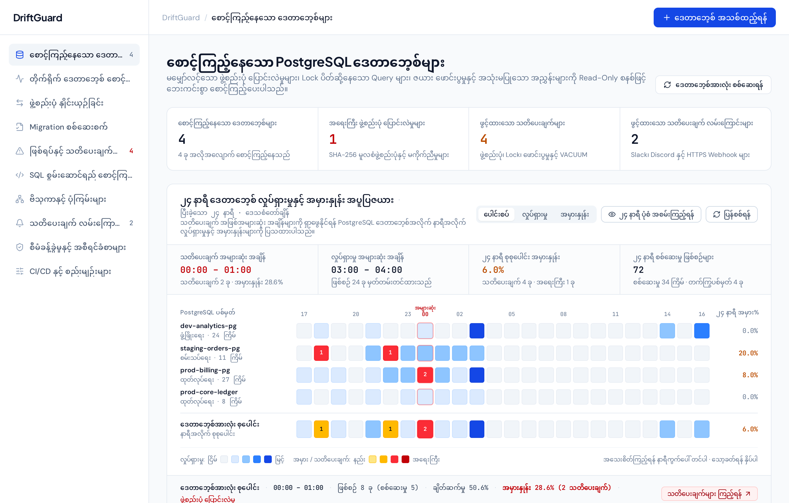

---

## Project Structure

```text
├── docs/screenshots/          # Live product screenshots embedded in README
├── src/
│   ├── components/            # Modular React views, Blocker Tree, Diagram Studio & visualizations
│   ├── context/               # Firebase Auth & Light/Dark Theme providers
│   ├── db/                    # Drizzle ORM schema, client & config
│   ├── i18n/                  # English & Burmese localization provider
│   ├── lib/                   # Typed frontend API client
│   ├── middleware/            # Firebase Admin Bearer auth middleware
│   ├── server/                # Inspector, live monitor, drift engine, telemetry & governance services
│   └── types/                 # Shared TypeScript DTO definitions
├── server.ts                  # Express API + Vite dev middleware entry point
└── vite.config.ts             # Vite + Tailwind v4 configuration
```
