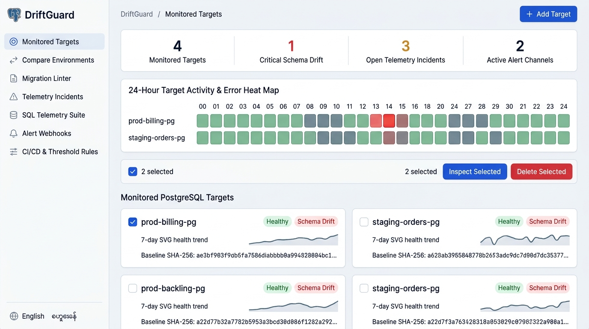
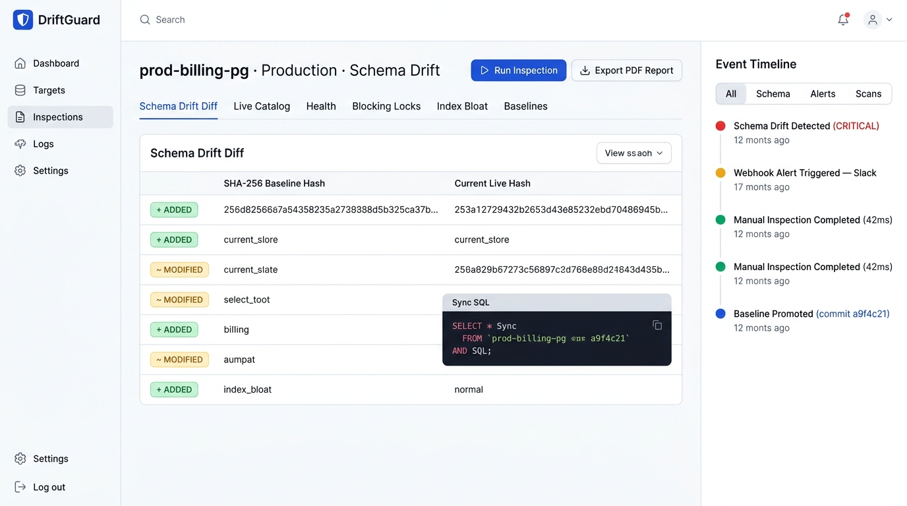
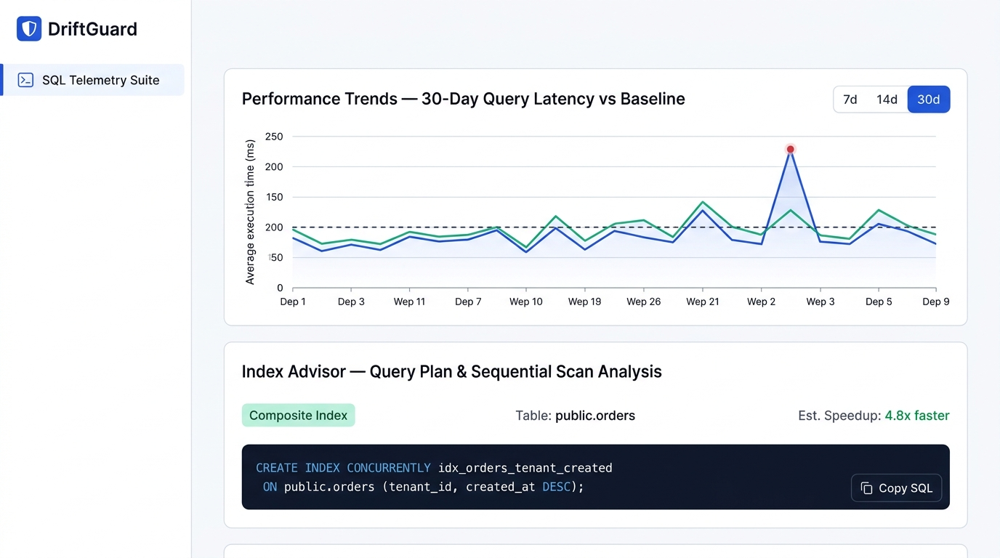
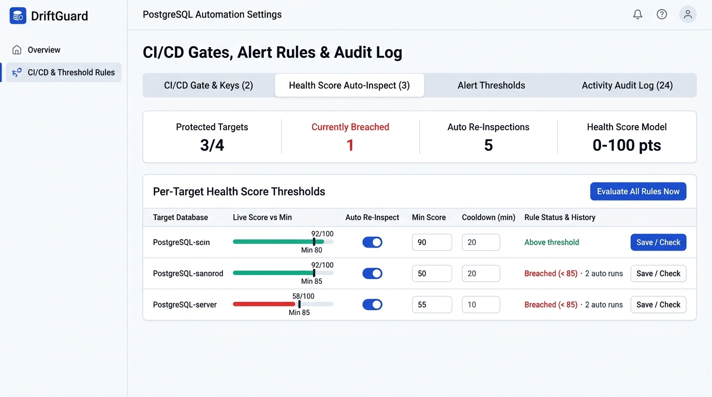

# DriftGuard

**PostgreSQL Schema Drift, Migration Safety & Telemetry SaaS**

[](https://www.postgresql.org/)
[](https://react.dev/)
[](https://www.typescriptlang.org/)
[](https://orm.drizzle.team/)
[](https://tailwindcss.com/)
[](#-localization)

DriftGuard is a production-grade PostgreSQL observability and schema governance platform. Using strictly **read-only catalog inspection**, it detects undocumented schema drift via canonical SHA-256 baselines, catches lock contention and index bloat before outages occur, analyzes slow queries and sequential scans, gates unsafe migrations in CI/CD pipelines, and automatically re-inspects databases when custom health score thresholds are breached.



---

## Core Capabilities

| Module | What It Does |
| :--- | :--- |
| **Canonical Schema Drift Detection** | Captures deterministic SHA-256 hashes of `information_schema.columns`, diffs live schemas against promoted Git baselines, and generates safe Sync SQL. |
| **24-Hour Activity & Error Heat Map** | Visualizes hourly target activity levels, inspection volume, and incident error rates across the fleet to pinpoint peak incident windows. |
| **7-Day Health Sparklines & Bulk Ops** | Displays 7-day health score sparklines on every target card and table row, with multi-select checkboxes for simultaneous **Inspect** and **Delete** operations. |
| **Target Detail & Event Timeline** | Inspects live catalogs, lock trees, index bloat, vacuum health, and baseline history alongside a chronological **Event Timeline** sidebar and **PDF Health Report** export. |
| **SQL Telemetry Suite** | Includes live `pg_stat_statements` query monitoring, **30-Day Performance Trends** vs. historical baselines, **Index Advisor** (`EXPLAIN` + sequential scan composite index recommendations), Live Lock Contention graph, Capacity Forecasting, and Vacuum/Bloat Anomaly Trends. |
| **Pre-Flight Migration Linter** | Statically audits DDL SQL migrations for table-locking operations (`ACCESS EXCLUSIVE`, non-concurrent indexes, missing lock timeouts) and outputs safe wrapped SQL. |
| **Environment Schema Comparison** | Side-by-side schema diffing between staging and production targets with one-click synchronization SQL generation. |
| **Health Score Auto-Inspection** | Configures custom 0–100 minimum health score thresholds and cooldown windows per database, automatically triggering verification re-inspections when breached. |
| **CI/CD Drift Gates & Webhooks** | Machine-to-machine API keys (`X-DriftGuard-Key`) for blocking drifted deploys in GitHub Actions, plus AES-256-GCM encrypted Slack, Discord, and HTTPS webhook alerting. |
| **Full EN / Burmese Localization** | Complete UI localization across English (`en`) and natural Burmese (`my`), including navigation, telemetry labels, alerts, dates, and modals. |

---

## Product Screenshots

### 1. Fleet Dashboard, 24-Hour Activity Heat Map & Bulk Target Operations
Monitor every PostgreSQL cluster across Production, Staging, and Development from a unified Grid or Table workspace. Spot peak incident hours on the 24-hour heat map, track 7-day health score sparklines per database, and run concurrent inspections or deletions via bulk selection.


---

### 2. Target Detail View, SHA-256 Schema Diff & Event Timeline
Drill into any monitored target to inspect column-level additions, removals, and type modifications against your promoted Git commit baseline, review blocking PID trees and index bloat, export a formatted PDF Health Report, and audit every schema change, alert trigger, and manual scan in the chronological **Event Timeline** sidebar.



---

### 3. SQL Telemetry Suite — 30-Day Performance Trends & Index Advisor
Spot query latency regressions over 7, 14, or 30 days compared against historical baselines, and use the **Index Advisor** to analyze `EXPLAIN` query plans and high-latency sequential scans to generate copy-ready `CREATE INDEX CONCURRENTLY` single and composite index statements.



---

### 4. CI/CD Gates & Per-Target Health Score Auto-Inspection
Configure custom minimum 0–100 health score thresholds and anti-loop cooldown windows per database. Whenever a database's computed health score drops below its threshold, DriftGuard automatically executes a verification re-inspection and records the event in the immutable Activity Audit Log.



---

## Architecture & Tech Stack

```text
┌──────────────────────────────────────────────────────────────────────┐
│                        React 19 + Vite SPA                           │
│   Tailwind CSS v4 · Lucide Icons · Custom SVG Charts · EN/MY i18n    │
│   Firebase Client Auth (Bearer ID Tokens)                            │
└─────────────────────────────────┬────────────────────────────────────┘
                                  │ HTTPS / JSON API (/api/*)
┌─────────────────────────────────▼────────────────────────────────────┐
│                    Express + TypeScript Server                       │
│  • Firebase Admin Auth Middleware + Zod Request Validation           │
│  • AES-256-GCM Secret Vault (HKDF Key Derivation)                    │
│  • SSRF Guard (DNS Resolution & Private/Link-Local IP Blocking)      │
│  • Read-Only PostgreSQL Inspector (statement_timeout + read-only tx) │
│  • Per-Target Health Score Evaluator & 60s Background Watcher        │
│  • PDFKit Health Report Generator & Webhook Dispatcher               │
└───────────────┬─────────────────────────────────────┬────────────────┘
                │ Drizzle ORM                         │ Read-Only pg Pool
┌───────────────▼──────────────────┐   ┌──────────────▼────────────────┐
│   DriftGuard Control Plane DB    │   │   Monitored Target Clusters   │
│   PostgreSQL / Cloud SQL         │   │   PostgreSQL 13+ (Prod/Stg)   │
│   11 Normalized Tables           │   │   information_schema,         │
│   (Users, Targets, Baselines,    │   │   pg_stat_statements,         │
│    Snapshots, Incidents,         │   │   pg_stat_user_tables,        │
│    Thresholds, Webhooks, Audit)  │   │   pg_locks, pg_stat_activity  │
└──────────────────────────────────┘   └───────────────────────────────┘
```

### Tech Stack
- **Frontend:** React 19, TypeScript, Vite 8, Tailwind CSS v4, Lucide React
- **Backend:** Node.js, Express 4, TypeScript (`tsx`), Zod 4, PDFKit
- **Database & ORM:** PostgreSQL (Cloud SQL), Drizzle ORM, `pg`
- **Authentication:** Firebase Authentication (Client SDK + `firebase-admin` server verification)

---

## Getting Started

### Prerequisites
- **Node.js 20+**
- **PostgreSQL 13+** (for the DriftGuard control plane database)
- **Firebase Project** with Authentication enabled (Google / Email-Password)

### 1. Clone & Install Dependencies

```bash
git clone <your-github-repo-url>
cd driftguard
npm install
```

### 2. Configure Environment Variables

Copy `.env.example` to `.env` and fill in your values:

```bash
cp .env.example .env
```

| Variable | Required | Description |
| :--- | :---: | :--- |
| `SQL_HOST` | Yes | Control-plane PostgreSQL host (or Cloud SQL socket/IP) |
| `SQL_DB_NAME` | Yes | Control-plane PostgreSQL database name |
| `SQL_USER` / `SQL_PASSWORD` | Yes | Application database credentials |
| `ENCRYPTION_KEY` | Recommended | 32+ character secret for AES-256-GCM encryption of target URIs & webhook URLs |
| `APP_URL` | Optional | Public URL of your DriftGuard deployment |

Configure `firebase-applet-config.json` with your Firebase Web App credentials.

### 3. Push Database Schema

```bash
npx drizzle-kit push --config=src/db/drizzle.config.ts
```

### 4. Run Locally

```bash
# Development server (Express API + Vite middleware on port 3000)
npm run dev

# Type-check
npm run lint

# Production build & start
npm run build
npm start
```

Open **http://localhost:3000** in your browser.

---

## Provisioning a Read-Only Target Role

DriftGuard only ever executes read-only metadata and telemetry queries. To connect an external PostgreSQL 13+ cluster safely, create a dedicated least-privilege role:

```sql
CREATE ROLE driftguard_ro WITH LOGIN PASSWORD 'replace-with-strong-password';
GRANT pg_monitor TO driftguard_ro;
GRANT CONNECT ON DATABASE your_database TO driftguard_ro;
GRANT USAGE ON SCHEMA public TO driftguard_ro;
GRANT SELECT ON ALL TABLES IN SCHEMA information_schema TO driftguard_ro;
```

> Enable `pg_stat_statements` on target databases to unlock **Query Performance**, **30-Day Performance Trends**, and **Index Advisor** query plan analysis.

---

## CI/CD GitHub Actions Schema Gate

Block pull requests automatically (HTTP `409`) whenever undocumented schema drift is detected, and promote the new Git commit SHA baseline right after production migrations succeed:

```yaml
name: DriftGuard Schema Gate
on:
  pull_request:
    branches: [main]
  push:
    branches: [main]

jobs:
  schema-drift-check:
    runs-on: ubuntu-latest
    steps:
      - name: Verify zero undocumented drift before deploy
        run: |
          curl --fail-with-body -sS -X POST "${{ vars.DRIFTGUARD_URL }}/api/ci/check-drift" \
            -H "Content-Type: application/json" \
            -H "X-DriftGuard-Key: ${{ secrets.DRIFTGUARD_API_KEY }}" \
            -d '{"databaseId":"${{ vars.DRIFTGUARD_TARGET_ID }}"}'

      - name: Promote new Git baseline after production migration
        if: github.ref == 'refs/heads/main'
        run: |
          curl --fail-with-body -sS -X POST "${{ vars.DRIFTGUARD_URL }}/api/ci/check-drift" \
            -H "Content-Type: application/json" \
            -H "X-DriftGuard-Key: ${{ secrets.DRIFTGUARD_API_KEY }}" \
            -d '{"databaseId":"${{ vars.DRIFTGUARD_TARGET_ID }}","promoteBaseline":true,"gitCommitSha":"${{ github.sha }}"}'
```

---

## API Reference Overview

All `/api/*` endpoints (except `/api/health` and `/api/ci/check-drift`) require a valid Firebase ID token via `Authorization: Bearer <token>` and enforce strict per-user `ownerUid` tenant isolation.

| Domain | Endpoints |
| :--- | :--- |
| **Targets & Bulk Ops** | `GET /api/databases`, `POST /api/databases`, `PATCH /api/databases/:id`, `DELETE /api/databases/:id`, `POST /api/databases/:id/inspect`, `POST /api/databases/inspect-all`, `POST /api/databases/bulk-inspect`, `POST /api/databases/bulk-delete` |
| **Detail, Timeline & PDF** | `GET /api/databases/:id`, `GET /api/databases/:id/timeline`, `GET /api/databases/:id/health-report`, `GET /api/dashboard/activity-heatmap` |
| **Baselines & Compare** | `POST /api/databases/:id/baselines`, `POST /api/databases/:id/baselines/:baselineId/restore`, `GET /api/databases/:id/compare-baselines`, `POST /api/compare` |
| **SQL Telemetry Suite** | `GET /api/telemetry-suite`, `GET /api/telemetry-suite/performance`, `GET /api/telemetry-suite/performance-trends`, `GET /api/telemetry-suite/index-advisor`, `POST /api/telemetry-suite/index-advisor/explain`, `GET /api/telemetry-suite/locks`, `GET /api/telemetry-suite/capacity`, `GET /api/telemetry-suite/trends` |
| **Migration Linter** | `GET /api/migrations`, `POST /api/migrations/analyze`, `DELETE /api/migrations/:id` |
| **Incidents & Webhooks** | `GET /api/incidents`, `PATCH /api/incidents/:id`, `GET/POST/PATCH/DELETE /api/webhooks`, `POST /api/webhooks/:id/test` |
| **Automation & Rules** | `GET/PUT /api/settings`, `GET /api/settings/target-thresholds`, `PUT /api/settings/target-thresholds/:databaseId`, `POST /api/settings/target-thresholds/evaluate`, `GET/POST/DELETE /api/api-keys`, `GET /api/audit-logs`, `POST /api/ci/check-drift` |

---

## Security Architecture

- **Encrypted Credential Storage:** External PostgreSQL URIs and webhook URLs are encrypted at rest with **AES-256-GCM** using deterministic HKDF key derivation and never returned in plaintext API responses.
- **SSRF Protection:** Outbound database and webhook URLs are validated against private, loopback, and cloud metadata IP ranges before connection attempts.
- **Strict Tenant Isolation:** Every query, inspection, baseline, incident, threshold rule, and bulk operation is scoped to the authenticated user's `ownerUid`.
- **Safe Read-Only Inspection:** Target scans execute inside `SET TRANSACTION READ ONLY` with strict statement timeouts; `EXPLAIN` plan analysis strictly blocks non-`SELECT` statements.
- **Anti-Loop Auto-Inspection Guards:** Per-target health score re-inspections enforce configurable cooldown intervals, in-memory concurrency locks, and single-pass follow-up guards.

---

## Localization

DriftGuard supports instant runtime language switching between **English (`en`)** and **Burmese (`my`)** from the sidebar and sign-in screen. All navigation, dashboard KPIs, charts, SQL telemetry explanations, migration warnings, bulk controls, and date/time formatting adapt automatically.

---

## Project Structure

```text
├── docs/screenshots/          # Product UI screenshots embedded in README
├── src/
│   ├── components/            # Modular React views & visualizations
│   ├── context/               # Firebase Auth context
│   ├── db/                    # Drizzle ORM schema, client & config
│   ├── i18n/                  # English & Burmese localization provider
│   ├── lib/                   # Typed frontend API client
│   ├── middleware/            # Firebase Admin Bearer auth middleware
│   ├── server/                # Inspector, drift engine, telemetry & health threshold services
│   └── types/                 # Shared TypeScript DTO definitions
├── server.ts                  # Express API + Vite dev middleware entry point
└── vite.config.ts             # Vite + Tailwind v4 configuration
```
